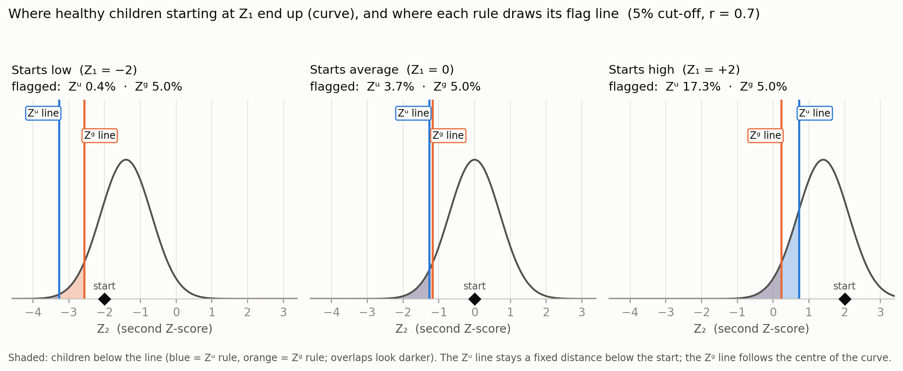
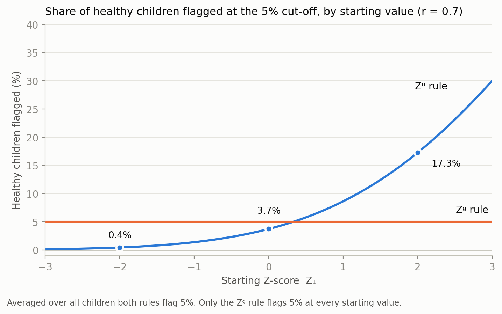

A growth chart is good at telling a parent **where** a child is. It is much worse at telling whether the child's **growth** has been normal. This post is my set of study notes on one paper that tackles exactly this:

> van Buuren S. (2023). *Evaluation and prediction of individual growth trajectories.* Annals of Human Biology, 50(1), 247–257. [doi:10.1080/03014460.2023.2190619](https://doi.org/10.1080/03014460.2023.2190619) (open access, CC BY 4.0)

The paper builds a yardstick for individual growth, the **conditional SDS gain**, one fix at a time. I wrote these notes as a sequence of questions that came up while reading, and I answer each with a short derivation and a numerical example.

- **Part I** explains the concepts in order, from raw velocity to the conditional SDS gain.
- **Part II** collects the questions that, for me, made the ideas click. Each answer contains a proof or derivation and a worked example.

::: {.callout-note}
## How to read the numbers

- Numbers marked *(illustrative)* are round numbers I chose to make an idea easy to see. They are not real growth-reference values.
- Correlations labelled "Table 2" come from the paper (SMOCC study, height correlations between ages in months).
- Everything else I computed myself, and checked with a simulation. The code is in the [appendix](#appendix-code).
- I use "healthy" loosely for "a child from the reference population who is growing normally". The reference sample in the paper is a representative sample of Dutch children, not a screened-healthy group.
:::

# Part I: The concepts {#part-1}

## 1. The problem: where a child is is not how the child is growing

A conventional growth chart is a **distance reference**. It shows how size varies with age and sex, so you can read off where a child stands among peers. Two things limit it for individual follow-up:

- Differences in the *tempo* of growth between children can make distance references biased and inefficient for studying individual growth, especially during puberty.
- What clinicians want to detect is usually **unexpected change** (failure to thrive, slow persistent deceleration, developmental delay), and a single position on a chart does not measure change.

So we need a number for *change* that can be read the same way at any age, for any interval between visits, and for any starting point. The paper gets there in four steps: velocity $V$, velocity in SDS units $W$, the unconditional SDS gain $Z^{u}$, and finally the conditional SDS gain $Z^{g}$.

## 2. Notation and the standing assumption

| Symbol | Meaning |
|:--|:--|
| $Y_t$ | Raw measurement (for example length in cm) at age $T_t$ |
| $Z_t$ | SDS (Z-score) of $Y_t$ for the child's age and sex |
| $r$ | Correlation between $Z_1$ and $Z_2$ for the two ages $T_1$ and $T_2$ |
| $\Phi$ | Standard normal cumulative distribution function |
| $\sigma_u$, $\sigma_g$ | $\sqrt{2-2r}$ and $\sqrt{1-r^2}$ |
| $L=\{D,R\}$ | Longitudinal reference: a distance reference $D$ plus a time-to-time correlation matrix $R$ |

**Standing assumption (A).** For children in the reference population, $(Z_1, Z_2)$ is bivariate normal with $E[Z_1]=E[Z_2]=0$, $\operatorname{Var}(Z_1)=\operatorname{Var}(Z_2)=1$ and $\operatorname{Corr}(Z_1,Z_2)=r$, with $|r|<1$. Every proof below uses only this.

## 3. Step 0: Z-scores (SDS) put sizes on one ruler {#sec-sds}

A raw size means different things at different ages. A Z-score compares the child with the reference for the **same age and sex** and counts how many reference standard deviations away the child is:

$$
Z=\frac{Y-\mu(\text{age},\text{sex})}{\sigma(\text{age},\text{sex})}
$$

**What a standard deviation is.** It is the typical distance of individuals from the mean, in the units of the data. Take five newborn lengths, 48, 50, 50, 50 and 52 cm. The mean is 50, the squared deviations are 4, 0, 0, 0, 4, their average is 1.6, so the SD is $\sqrt{1.6}\approx 1.26$ cm.

**What a Z-score means.** If the reference is approximately normal, a Z-value corresponds to a fixed percentile at every age:

| Z | Share of the reference below this value |
|--:|--:|
| −2 | 2.3% |
| −1.645 | 5.0% |
| −1 | 15.9% |
| 0 | 50% |
| +1 | 84.1% |
| +2 | 97.7% |

"Mean 0 and SD 1" describes the **reference population** after the transformation. An individual child has one Z value, and that value is the number of reference SDs above or below the mean.

### Before and after converting (illustrative)

Suppose these are the reference values for girls' length:

| Age | Reference mean (cm) | Reference SD (cm) | Middle 68% (mean ± 1 SD) |
|:--|--:|--:|:--|
| Birth | 50 | 2.0 | 48.0 to 52.0 (4.0 cm wide) |
| 6 months | 66 | 2.3 | 63.7 to 68.3 (4.6 cm wide) |
| 12 months | 74 | 2.6 | 71.4 to 76.6 (5.2 cm wide) |
| 24 months | 86 | 3.2 | 82.8 to 89.2 (6.4 cm wide) |

In centimetres, both the average (50 to 86) and the spread (2 to 3.2) move with age. So "3 cm above average" means different things at different ages.

**Example A: the same +3 cm at different ages.** Emma is 53 cm at birth and Lena is 89 cm at 24 months. Both are 3 cm above the average for their age.

$$
Z_{\text{Emma}}=\frac{53-50}{2.0}=+1.50\;(93\text{rd centile}),\qquad
Z_{\text{Lena}}=\frac{89-86}{3.2}=+0.94\;(83\text{rd centile})
$$

In centimetres the two look identical. In Z-scores Emma is clearly the more unusual of the two.

**Example B: following one child.** A girl who measures 50, 66, 74 and 86 cm at birth, 6, 12 and 24 months has the Z-scores $0, 0, 0, 0$. She is growing exactly along the median. A second girl with 50 cm at birth and 71.4 cm at 12 months grew 21.4 cm, which looks like a lot, but $Z=(71.4-74)/2.6=-1.0$. She has fallen from the 50th to the 16th centile. Only the Z-scale shows this.

::: {.callout-important}
## What Z-scores do and do not give you
Z-scores make **size** comparable across ages. They say nothing about **change**. The rest of the post is about measuring change.
:::

## 4. Step 1: Velocity $V$

$$
V=\frac{Y_2-Y_1}{T_2-T_1}
$$

Velocity is easy to compute (for example cm per year) and a low value shows up on a growth chart as a downward centile crossing. But a normal velocity depends on age and sex (fast in infancy, slower later, a spurt in puberty), and so does its spread. A single velocity number cannot be read without an age- and sex-specific reference.

## 5. Step 2: Velocity in SDS units $W$ {#sec-w}

Replace sizes by Z-scores:

$$
W=\frac{Z_2-Z_1}{T_2-T_1}\qquad(\text{SDS per year})
$$

This removes the dependence of the **level** on age and sex. But the **variability of the change** still depends on the interval, because it depends on $r$:

$$
\operatorname{Var}(Z_2-Z_1)=1+1-2r=2-2r,\qquad
\operatorname{SD}(W)=\frac{\sqrt{2-2r}}{T_2-T_1}
$$

Over a short gap, or later in childhood, children keep their centile and $r$ is high, so even small changes are unusual. In infancy children reshuffle more, so $r$ is lower and bigger changes are normal. Here is the same slope of $-1$ SDS per year at three different times (correlations from Table 2, height):

| Interval | $r$ | SD of $W$ (SDS/year) | A slope of −1 SDS/year is |
|:--|--:|--:|--:|
| Month 1 to 2 | 0.856 | 6.44 | −0.16 SD from "no change" (noise) |
| Month 0 to 12 | 0.440 | 1.06 | −0.94 SD (normal) |
| Month 12 to 24 | 0.818 | 0.60 | −1.66 SD (unusual) |

The same number leads to different conclusions, so $W$ cannot be read at face value. The distribution of $W$ depends on $T_1$ and $T_2$.

## 6. Step 3: The unconditional SDS gain $Z^{u}$ {#sec-zu}

Cole (1995) proposed standardising the change by its own standard deviation:

$$
Z^{u}=\frac{Z_2-Z_1}{\sigma_u},\qquad \sigma_u=\sqrt{2-2r}
$$

Under (A), $Z_2-Z_1$ is normal with mean 0 and variance $2-2r$, so $Z^{u}\sim N(0,1)$ **for every pair of ages**. The dependence on the gap and on the age is absorbed into $r$, which is looked up for the specific pair of ages.

To flag the 5% most extreme changes you flag when $Z^{u}<-1.645$, which is the same as flagging when $Z_2-Z_1<-1.645\,\sigma_u$. The drop in $Z$ that is needed changes with the interval, and the rule adapts automatically:

| Interval | $r$ | $\sigma_u$ | Drop in $Z$ needed to flag ($1.645\,\sigma_u$) | Healthy children flagged by a fixed rule "drop of 1 SDS or more" |
|:--|--:|--:|--:|--:|
| Month 0 to 3 | 0.580 | 0.92 | 1.51 | 13.8% |
| Month 3 to 6 | 0.803 | 0.63 | 1.03 | 5.6% |
| Month 1 to 2 | 0.856 | 0.54 | 0.88 | 3.1% |
| Month 0 to 12 | 0.440 | 1.06 | 1.74 | 17.2% |
| Month 12 to 24 | 0.818 | 0.60 | 0.99 | 4.9% |

A fixed cut-off such as "a drop of 1 SDS" flags between 3% and 17% of healthy children depending on the interval. $Z^{u}<-1.645$ flags 5% at every interval, by construction. (The percentages assume normality.)

**What $Z^{u}$ solves.** The age and interval dependence of the spread of change. One cut-off now has one meaning everywhere.

**What $Z^{u}$ does not solve.**

- It assumes the expected change is **zero** (a child is expected to stay on their centile). That ignores regression to the mean (next section), which is the main flaw.
- It uses only two measurements.
- It is the change over the interval, not a rate per year.
- It needs roughly bivariate normal Z-scores and a trustworthy $r$ for the exact pair of ages.

## 7. Regression to the mean {#sec-rtm}

::: {.callout-note}
## Analogy
If you score 90 on a test where the class average is 70, and the test is only a partly reliable measure of your ability, the best guess for your next score is not 90. Part of that 90 was luck, so you pull the guess back toward the average, in proportion to how unreliable the test is.
:::

For standardised variables with correlation $r$, the best prediction of $Z_2$ given $Z_1$ is

$$
E[Z_2\mid Z_1]=r\,Z_1
$$

so the expected change is $(r-1)Z_1$. A child who starts below average (negative $Z_1$) is expected to rise, and one who starts above average is expected to fall. If $r=1$ nothing regresses. If $r=0$ the child is fully pulled back to 0. With $r=0.7$ and $Z_1=-2$, the expected next value is $-1.4$ and the expected gain is $+0.6$.

The paper stresses that this variation comes partly from measurement error and partly from real biological differences in growth.

## 8. Step 4: The conditional SDS gain $Z^{g}$ {#sec-zg}

The fix is to compare the child with what was **expected given where they started**, and not with where they started:

$$
Z^{g}=\frac{Z_2-r\,Z_1}{\sigma_g},\qquad \sigma_g=\sqrt{1-r^{2}}
$$

The recipe has three parts:

1. **Predict** the next Z-score by shrinking the previous one toward 0: $\hat Z_2=r\,Z_1$.
2. **Take the surprise**, the actual minus the predicted value: $Z_2-r\,Z_1$.
3. **Scale** it by the typical size of that surprise, $\sqrt{1-r^2}$. This is the variance left over after $Z_1$ has explained a share $r^2$ of the variance of $Z_2$.

Under (A), $Z^{g}\sim N(0,1)$ for every starting value $Z_1$. This is proved in [Q6](#q6).

### Worked example: the paper's Figure 1 child

A girl has length 58 cm at 2 months and 65 cm at 6 months, and Table 2 gives $r=0.745$ for these ages. Reading her Z-scores off the paper's Figure 1 (approximately), $Z_2\approx+0.57$ and $Z_6\approx-0.62$.

| Quantity | Calculation | Value |
|:--|:--|--:|
| Predicted $Z_6$ | $0.745\times0.57$ | 0.425 |
| Surprise | $-0.62-0.425$ | −1.045 |
| $\sigma_g$ | $\sqrt{1-0.745^2}$ | 0.667 |
| $Z^{g}$ | $-1.045/0.667$ | **−1.57** |
| $Z^{u}$ for comparison | $(-0.62-0.57)/\sqrt{2-2(0.745)}$ | −1.67 |

The paper reports $Z^{g}=-1.57$, just above the thrive line at $-1.645$, so she is not flagged. $Z^{u}$ would flag her, because she started above average ($Z_2=+0.57$) and some drop was expected.

The difference between the two rules is exactly the regression-to-the-mean term. Rewrite the numerator of $Z^{g}$:

$$
Z_2-rZ_1=(Z_2-Z_1)+(1-r)\,Z_1
$$

The first term is the plain change that $Z^{u}$ uses. The second term is the correction: positive for children who start high (credit for the expected drop) and negative for children who start low (a penalty for not catching up). Here it is $0.255\times0.57=0.145$, and $-1.19+0.145=-1.045$.

A second child makes the point. Take $Z_2=-0.5$ and $Z_6=-1.69$, which is the **same drop of 1.19**. Then $Z^{u}=-1.67$ again, but $Z^{g}=(-1.69+0.3725)/0.667=-1.98$. $Z^{u}$ cannot tell the two children apart, and $Z^{g}$ can. The second child was expected to rise and fell instead.

## 9. Choosing a cut-off: the thrive line {#sec-thrive}

Because $Z^{g}$ is standard normal, a cut-off has a precise meaning: $Z^{g}=-1.645$ means that only 5% of reference children grow this badly or worse over that interval. Following Wright et al. (1994), the paper calls this the **thrive line** and uses it as a criterion for finding children with failure to thrive. The 5% level is a convention, not a law:

| Share of reference children flagged | Z cut-off |
|--:|--:|
| 5% | −1.645 |
| 2.5% | −1.960 |
| 1% | −2.326 |

A looser cut-off catches more real problems but produces more false alarms. A stricter one does the reverse. Repeated visits make this worse. Over the paper's 10 visits there are 9 evaluations (birth has no earlier measurement), and at the 5% cut-off the binomial calculation $1-0.95^{9}$ predicts that 37.0% of children are flagged at least once. In the real data it was 28.2% for weight and 30.5% for height. With a 1% cut-off the binomial value is 8.6% (8.4% for weight and 8.9% for height observed). That is the multiple-testing problem in the paper's Table 5. A flag means "look closer", not "diagnosis".

## 10. Reference cohort versus a new child {#sec-two-phases}

$Z^{g}$ works in two phases.

**Phase 1: build the longitudinal reference (once).** From a reference sample of repeatedly measured children (in the paper, 1,895 term-born SMOCC children with at least four visits), convert measurements to Z-scores using a distance reference $D$ (the Fourth Dutch Growth Study) and estimate the time-to-time correlations $R$ (Table 2). Together they form $L=\{D,R\}$.

**Phase 2: apply it to a new child.** Convert the child's measurements to Z-scores with $D$, take $r$ from $R$ (interpolated for other ages by the Cole correlation model), compute the expected value $rZ_1$, and compute $Z^{g}=(Z_2-rZ_1)/\sqrt{1-r^2}$.

Nothing about the new child is used to estimate $r$ or $D$. The validity condition is that the child comes from a population like the reference. The paper's rule of thumb is that the mean Z-score of the target sample should lie within ±0.1 SD.

## 11. At a glance

| Measure | What it fixes | What remains |
|:--|:--|:--|
| $V$ (cm/year) | nothing; raw change | depends on age and sex |
| $Z$ (SDS) | makes **size** comparable across ages | says nothing about change |
| $W$ (SDS/year) | change in Z-units | spread depends on the gap and the age |
| $Z^{u}$ | spread standardised, $N(0,1)$ for any pair of ages | ignores regression to the mean |
| $Z^{g}$ | also corrects for regression to the mean, $N(0,1)$ for every start | uses only the information supplied (see next section) |

## 12. Preview: beyond two measurements {#sec-preview}

The paper's main extension is to condition on **all** previous measurements, not only the last one. I will cover the derivation in a follow-up post. The ingredients are:

- **Regression weights.** For measurements at ages 1, 2 and 6 months the expected value becomes $\beta_1Z_1+\beta_2Z_2$ with
  $$
  \beta_1=\frac{r_{16}-r_{26}r_{12}}{1-r_{12}^2},\quad
  \beta_2=\frac{r_{26}-r_{16}r_{12}}{1-r_{12}^2},\quad
  r^2=\frac{r_{16}^2+r_{26}^2-2r_{12}r_{16}r_{26}}{1-r_{12}^2},
  $$
  and $Z^{g}_6=\dfrac{Z_6-(\beta_1Z_1+\beta_2Z_2)}{\sqrt{1-r^2}}$. For more points the paper uses the **sweep operator**, which gives $\beta$ and the residual variance from the correlation matrix.
- **Arbitrary ages.** Table 2 only covers ten scheduled ages, so the paper models the Fisher-transformed correlation as a function of the two ages (the Cole correlation model; adjusted $R^2$ of 0.997 for weight and 0.971 for height).
- **The adaptive growth chart.** The child's curve is shown with a reference band and two new elements: an *amplitude* (the series of conditional gains) and a *flag* (a prediction band for the next measurement).

The paper's own example, using the height correlations from Table 2 ($r_{16}=0.691$, $r_{26}=0.745$, $r_{12}=0.856$, giving $\beta_1\approx0.198$, $\beta_2\approx0.575$, $r^2\approx0.566$), shows how an extra measurement changes the story:

| Measurements used | $Z^{g}$ at 6 months |
|:--|--:|
| Month 2 only (the Figure 1 child above) | −1.57 (not flagged) |
| Months 1 and 2, $Y_1=56$ cm ($Z_1=+1.065$) | −1.76 (flagged) |
| Months 1 and 2, $Y_1=53$ cm ($Z_1=-0.432$) | −1.31 (not flagged) |

I reproduced all three values from the Z-scores, which also confirms my reading of $Z_2$ and $Z_6$ off Figure 1.

In the paper's validation on the SMOCC data (Table 4), the SD of $Z^{g}$ is close to 1 (about 1.0 for weight and 1.05 for height), and 4.0 to 4.5% of children fall below the 5th-centile thrive line, close to the nominal 5%. Using all historic measurements barely changed the explained variance compared with using only the last measurement (79.3% versus 79.6% for weight, 73.1% versus 72.6% for height), and the paper therefore suggests including at least the last two measurements.

# Part II: Questions and answers {#part-2}

## Q1. What does "1 SD above average" mean once everything has mean 0 and SD 1? {#q1}

::: {.callout-tip}
## Short answer
Mean 0 and SD 1 describe the reference population, not a child. A child's Z is the number of reference SDs they are from the mean, and it corresponds to the same percentile at every age.
:::

**Proof that Z is comparable across ages.** Suppose that at age $a$ the reference is normal, $Y\sim N(\mu_a,\sigma_a^2)$. Then

$$
P(Z\le z)=P\!\left(\frac{Y-\mu_a}{\sigma_a}\le z\right)=P(Y\le\mu_a+\sigma_a z)=\Phi(z)
$$

for **every** $a$. So $Z=+1$ means the 84.1st centile whether the child is a newborn or a 2-year-old, and the 5% thrive line is $Z=-1.645$ at every age. The SD is not lost, it is absorbed into the unit: one reference SD is 2.0 cm at birth and 3.2 cm at 24 months in the [illustrative table](#sec-sds), but it is exactly 1 on the Z-scale.

**Example.** A 3 cm excess is $Z=+1.50$ at birth and $Z=+0.94$ at 24 months. The same raw excess is a larger deviation where the SD is smaller. Without converting, you cannot compare the two children.

## Q2. Are velocity $V$ and SDS-velocity $W$ the same problem? {#q2}

::: {.callout-tip}
## Short answer
No. They are two different problems, and fixing the first leaves the second in place.
:::

- **$V$ has a scale problem.** Centimetres are not comparable across ages. A typical $V$ is about 25 cm/year in infancy and about 6 cm/year at age 8, so "10 cm/year" is fast at one age and slow at another. Standardising the sizes ($Y\to Z$) fixes this and gives $W$.
- **$W$ has a variance problem.** After standardising, the **change** in $Z$ is still not equally variable everywhere:

$$
\operatorname{SD}(W)=\frac{\sqrt{2-2r}}{T_2-T_1}
$$

The time dependence enters in two ways, both through $r$: the **length of the gap** (a short gap gives a high $r$ and a small spread) and the **age** (for the same gap, infants are less stable than older children, so $r$ is lower and the spread larger). The table in [Step 2](#sec-w) shows the same slope of $-1$ SDS/year as noise (month 1 to 2), normal (month 0 to 12) and unusual (month 12 to 24).

**Analogy.** A 2-second improvement in a swimming race is small for a beginner whose times wobble by ±3 seconds, and large for an elite swimmer whose times wobble by ±0.3 seconds. Fixing the units of time does not fix the difference in wobble.

## Q3. How does $Z^{u}$ remove the dependence on the gap and the age, and what does "a single threshold works everywhere" mean? {#q3}

::: {.callout-tip}
## Short answer
$Z^{u}$ divides the change by its own SD, $\sqrt{2-2r}$, with $r$ looked up for that exact pair of ages. The dependence on gap and age lives only in $r$, so dividing by $\sqrt{2-2r}$ removes it. The same cut-off then flags the same share of children at every interval.
:::

**Derivation.** Under (A), $Z_2-Z_1$ is a linear combination of normal variables, so it is normal. Its mean is $0$ and its variance is

$$
\operatorname{Var}(Z_2-Z_1)=\operatorname{Var}(Z_2)+\operatorname{Var}(Z_1)-2\operatorname{Cov}(Z_1,Z_2)=1+1-2r
$$

Dividing a $N(0,2-2r)$ variable by $\sqrt{2-2r}$ gives $N(0,1)$, whatever $r$ is.

**What "a single threshold" means.** Define "right" as flagging the intended share (5%) of healthy children at any pair of ages. For healthy children $Z_2-Z_1\sim N(0,\sigma_u^2)$, so the fixed rule "flag a drop of at least 1 SDS" flags $\Phi(-1/\sigma_u)$ of them. The table in [Step 3](#sec-zu) gives 13.8%, 5.6%, 3.1%, 17.2% and 4.9% for five intervals: far too many false alarms in some intervals and too few in others. With $Z^{u}<-1.645$ the share is $\Phi(-1.645)=5\%$ for every interval.

Equivalently, $Z^{u}<-1.645$ means $Z_2-Z_1<-1.645\,\sigma_u$, so the drop in $Z$ needed to flag changes with the interval (1.51 for month 0 to 3, 1.03 for month 3 to 6). Dividing by $\sigma_u$ is the age-specific adjustment.

**Example.** Two children both drop exactly 1.0 SDS. Child P is measured at 0 and 3 months, so $Z^{u}=-1/0.917=-1.09$, which is unremarkable. Child Q is measured at 3 and 6 months, so $Z^{u}=-1/0.628=-1.59$, which is just above the thrive line. The raw drops are identical, but Q's drop is much more unusual because children of that age normally change less.

## Q4. Why the 5th-centile "thrive line"? {#q4}

::: {.callout-tip}
## Short answer
It is a pre-chosen tripwire, not a mathematical property. $-1.645$ is the Z-value with 5% of the normal distribution below it, so the rule flags 1 in 20 children from the reference population at each evaluation.
:::

The analogy is airport security. They cannot open every bag, so they decide in advance to pull aside a fixed share for a manual check. A bag being pulled aside does not mean it is dangerous, only that it is unusual enough to look at.

In the paper the thrive line is the 5th centile of the **conditional** gain $Z^{g}$ (the idea is from Wright et al., 1994), so it says "only 5% of reference children grow this badly or worse over that interval". It is one-sided because the clinical worry is growth faltering.

The choice of 5% is a trade-off between sensitivity and false alarms, and the table of cut-offs in [Section 9](#sec-thrive) shows the alternatives (2.5%: $-1.96$; 1%: $-2.326$). The right level depends on what happens after a flag: a cheap follow-up (a re-weigh) justifies a looser line. The accumulation over repeated visits (37.0% flagged at least once over the paper's 9 evaluations at 5%, see [Section 9](#sec-thrive)) is a further reason the cut-off need not be 5%.

## Q5. What is $\varepsilon$, and why is $\operatorname{Cov}(\varepsilon, Z_1)=0$? {#q5}

::: {.callout-tip}
## Short answer
$\varepsilon$ is the part of $Z_2$ that $Z_1$ cannot predict. It has zero covariance with $Z_1$ because $r$ is exactly the multiplier that removes everything in $Z_2$ that is linearly related to $Z_1$.
:::

Define the surprise

$$
\varepsilon = Z_2 - r\,Z_1\qquad\Longleftrightarrow\qquad Z_2=\underbrace{rZ_1}_{\text{predictable}}+\underbrace{\varepsilon}_{\text{unpredictable}}
$$

**Proof that $\operatorname{Cov}(\varepsilon,Z_1)=0$.** Use two rules of covariance: it splits over subtraction, and a constant can be pulled out.

$$
\begin{aligned}
\operatorname{Cov}(\varepsilon,Z_1)
&=\operatorname{Cov}(Z_2-rZ_1,\,Z_1)\\
&=\operatorname{Cov}(Z_2,Z_1)-r\operatorname{Cov}(Z_1,Z_1)\\
&=r-r\cdot 1=0
\end{aligned}
$$

Here $\operatorname{Cov}(Z_1,Z_1)=\operatorname{Var}(Z_1)=1$, and $\operatorname{Cov}(Z_2,Z_1)=r$ because the correlation is the covariance divided by two SDs that both equal 1.

**Why the multiplier is exactly $r$.** Subtract an unknown multiple $c$ instead:

$$
\operatorname{Cov}(Z_2-cZ_1,\,Z_1)=r-c
$$

This is zero only when $c=r$, which is also the least-squares slope of $Z_2$ on $Z_1$. Any other multiplier would leave some of $Z_1$ in the remainder.

**Variance of $\varepsilon$.**

$$
\operatorname{Var}(\varepsilon)=\operatorname{Var}(Z_2)-2r\operatorname{Cov}(Z_1,Z_2)+r^2\operatorname{Var}(Z_1)=1-2r^2+r^2=1-r^2
$$

**Numerical check** with $r=0.5$ and four children whose $Z_1$ and $Z_2$ have mean exactly 0 and variance 1:

| Child | $Z_1$ | $Z_2$ | $\varepsilon=Z_2-0.5Z_1$ | $\varepsilon\times Z_1$ |
|:--|--:|--:|--:|--:|
| 1 | −1 | −1.366 | −0.866 | +0.866 |
| 2 | −1 | +0.366 | +0.866 | −0.866 |
| 3 | +1 | +1.366 | +0.866 | +0.866 |
| 4 | +1 | −0.366 | −0.866 | −0.866 |

The mean of $Z_1Z_2$ is $0.5$ (so $r=0.5$), the mean of $\varepsilon Z_1$ is $0$, and $\operatorname{Var}(\varepsilon)=0.75=1-0.5^2$.

A caution: zero covariance means "uncorrelated". To upgrade it to **independent** we need joint normality, which is used in the next question.

## Q6. Prove that $Z^{g}$ is $N(0,1)$ for every starting value $Z_1$. Is it true that "independent of $Z_1$, hence normal for every start"? {#q6}

::: {.callout-tip}
## Short answer
Yes, the statement is true, but both ingredients are needed: $Z^{g}$ is itself $N(0,1)$, and it is independent of $Z_1$, so conditioning on $Z_1$ changes nothing.
:::

**Claim.** Under (A), for every fixed $z$,

$$
Z^{g}\mid Z_1=z\;\sim\;N(0,1)
$$

### Proof 1: independence

1. Let $\varepsilon=Z_2-rZ_1$. The pair $(Z_1,\varepsilon)$ is a linear transformation of $(Z_1,Z_2)$, so it is jointly normal with mean 0.
2. By Q5, $\operatorname{Cov}(Z_1,\varepsilon)=0$ and $\operatorname{Var}(\varepsilon)=1-r^2$.
3. **Jointly normal and uncorrelated implies independent.** The covariance matrix of $(Z_1,\varepsilon)$ is diagonal, so the joint density factorises:

$$
f(z_1,e)=\underbrace{\tfrac{1}{\sqrt{2\pi}}e^{-z_1^2/2}}_{f_{Z_1}(z_1)}\cdot\underbrace{\tfrac{1}{\sqrt{2\pi(1-r^2)}}e^{-e^2/(2(1-r^2))}}_{f_\varepsilon(e)}
$$

4. $Z^{g}=\varepsilon/\sqrt{1-r^2}$ is a scaled copy of $\varepsilon$, so $Z^{g}\sim N(0,1)$.
5. Because $Z^{g}$ depends only on $\varepsilon$, which is independent of $Z_1$, conditioning on $Z_1=z$ changes nothing:

$$
P(Z^{g}\le t\mid Z_1=z)=P(Z^{g}\le t)=\Phi(t)\quad\text{for every }z.\qquad\blacksquare
$$

### Proof 2: directly from the densities

Start with the bivariate normal density and the marginal of $Z_1$:

$$
f(z_1,z_2)=\frac{1}{2\pi\sqrt{1-r^2}}\exp\!\left(-\frac{z_1^2-2rz_1z_2+z_2^2}{2(1-r^2)}\right),\qquad
f(z_1)=\frac{1}{\sqrt{2\pi}}e^{-z_1^2/2}
$$

The conditional density is the ratio. The terms in the exponent combine as

$$
z_1^2-2rz_1z_2+z_2^2-(1-r^2)z_1^2=(z_2-rz_1)^2
$$

so

$$
f(z_2\mid z_1)=\frac{1}{\sqrt{2\pi(1-r^2)}}\exp\!\left(-\frac{(z_2-rz_1)^2}{2(1-r^2)}\right),
$$

which is the $N(rz_1,\,1-r^2)$ density. Change variables to $g=(z_2-rz_1)/\sqrt{1-r^2}$, so that $dz_2/dg=\sqrt{1-r^2}$:

$$
f_{Z^{g}\mid Z_1}(g\mid z_1)=f(z_2\mid z_1)\sqrt{1-r^2}=\frac{1}{\sqrt{2\pi}}e^{-g^2/2}.
$$

This does not contain $z_1$, and it is the standard normal density. $\blacksquare$

### Why both ingredients are needed

Independence alone would not give normality, and normality alone would not give "for every $Z_1$". If, say, $Z^{g}$ were $N(0,1)$ overall but its spread grew with $Z_1$, it would be normal in total and not conditional on $Z_1$. Joint normality is what makes zero covariance enough for independence.

**Numerical example.** With $r=0.7$ and $Z_1=-2$, the proof says $Z_2\mid Z_1=-2\sim N(-1.4,\,0.51)$, so $Z^{g}=(Z_2+1.4)/0.714$ is $N(0,1)$. For $Z_1=+2$, $Z_2\mid Z_1=2\sim N(1.4,\,0.51)$ and $Z^{g}=(Z_2-1.4)/0.714$ is again $N(0,1)$.

**Where it can fail.** The result is exact only under (A). If $(Z_1,Z_2)$ are not jointly normal, the true $E[Z_2\mid Z_1]$ need not be the straight line $rZ_1$ and the spread may vary with $Z_1$. The paper checks this empirically (Table 4), and its discussion warns that deviations from bivariate normality can hide subtle effects.

## Q7. $Z^{u}$ is $N(0,1)$ across all children, but not within a starting group. What does that mean? {#q7}

::: {.callout-tip}
## Short answer
$Z^{u}$ **is** normal within each starting group, but with the wrong centre and a spread below 1. Only the whole mixture of groups is standard normal.
:::

**Analogy.** A bathroom scale reads 2 kg too heavy for light people and 2 kg too light for heavy people. The average error over everyone is 0, so the scale looks fine overall, but it is wrong for every individual.

**Derivation.** Write $Z_2=rZ_1+\varepsilon$ with $\varepsilon$ independent of $Z_1$ and $\operatorname{Var}(\varepsilon)=1-r^2$ (Q5, Q6). Then $Z_2-Z_1=(r-1)Z_1+\varepsilon$, and conditional on $Z_1=z$:

$$
E[Z^{u}\mid Z_1=z]=\frac{(r-1)z}{\sqrt{2-2r}}=-\sqrt{\tfrac{1-r}{2}}\;z,\qquad
\operatorname{Var}[Z^{u}\mid Z_1=z]=\frac{1-r^2}{2-2r}=\frac{1+r}{2}
$$

So $Z^{u}\mid Z_1=z\sim N\!\left(-\sqrt{\tfrac{1-r}{2}}\,z,\ \tfrac{1+r}{2}\right)$. This is a bell curve, but with a mean that depends on $z$ and a variance below 1. For $r=0.7$:

| Starting $Z_1$ | Mean of $Z^{u}$ in the group | SD of $Z^{u}$ in the group |
|--:|--:|--:|
| −2 | +0.77 | 0.92 |
| −1 | +0.39 | 0.92 |
| 0 | 0.00 | 0.92 |
| +1 | −0.39 | 0.92 |
| +2 | −0.77 | 0.92 |

**Why the pooled result is still $N(0,1)$.** By the law of total variance,

$$
\operatorname{Var}(Z^{u})=E[\operatorname{Var}(Z^{u}\mid Z_1)]+\operatorname{Var}(E[Z^{u}\mid Z_1])=\frac{1+r}{2}+\frac{1-r}{2}\operatorname{Var}(Z_1)=1
$$

A neater way to see the structure is the identity

$$
Z^{u}=-\sqrt{\tfrac{1-r}{2}}\;Z_1+\sqrt{\tfrac{1+r}{2}}\;Z^{g},
$$

where $Z_1$ and $Z^{g}$ are independent and the squared weights add to 1. So $Z^{u}$ is a blend of the **starting value** and the genuinely new part $Z^{g}$. This also gives

$$
\operatorname{Corr}(Z^{u},Z_1)=-\sqrt{\tfrac{1-r}{2}}\approx-0.39\ (r=0.7),\qquad \operatorname{Corr}(Z^{g},Z_1)=0
$$

**Why this matters.** A single cut-off or percentile reading assumes $N(0,1)$ for the child in front of you, and that is the *conditional* statement. Also, a low $Z^{u}$ is partly just "started high", which can contaminate any later analysis that correlates $Z^{u}$ with something else.

## Q8. Where do 0.4%, 3.7% and 17.3% come from? {#q8}

::: {.callout-tip}
## Short answer
They are the shares of healthy children, starting at $Z_1=-2$, $0$ and $+2$, whose $Z^{u}$ falls below $-1.645$ just through normal variation.
:::

**Analogy.** Imagine a basketball hoop (the flag line) set a fixed distance below where a child started. Children do not land at their starting point. They land near $rZ_1$, pulled toward average. For a child who started low, the landing zone is *above* the start, so the hoop sits far below the landing zone and almost nobody falls under it. For a child who started high, the landing zone is *below* the start, so the hoop sits close to the landing zone and many fall under it.

**Step 1: where do healthy children starting at $Z_1$ end up?** From Q6, $Z_2\mid Z_1\sim N(rZ_1,\,1-r^2)$, which for $r=0.7$ is $N(0.7Z_1,\ 0.714^2)$.

**Step 2: where is the $Z^{u}$ flag line on the $Z_2$ axis?**

$$
Z^{u}<-1.645\iff Z_2<Z_1-1.645\sqrt{2-2r}=Z_1-1.274
$$

The line sits a fixed 1.274 below the start.

**Step 3: how far is the line from the centre of the landing zone?** In SD units this is $\dfrac{(Z_1-1.274)-0.7Z_1}{0.714}$, and the flag share is the normal tail area $\Phi(\text{distance})$:

| Start $Z_1$ | Landing centre ($0.7Z_1$) | $Z^{u}$ line ($Z_1-1.274$) | Distance in SD units | Share below the line |
|--:|--:|--:|--:|--:|
| −2 | −1.40 | −3.27 | −2.62 | 0.4% |
| −1 | −0.70 | −2.27 | −2.20 | 1.4% |
| 0 | 0.00 | −1.27 | −1.78 | 3.7% |
| +1 | +0.70 | −0.27 | −1.36 | 8.6% |
| +2 | +1.40 | +0.73 | −0.94 | 17.3% |

The two rules are drawn in @fig-landing. In general, $P(Z^{u}<c\mid Z_1=z)=\Phi\!\left(\dfrac{c+\sqrt{(1-r)/2}\,z}{\sqrt{(1+r)/2}}\right)$.

{#fig-landing fig-alt="Three panels showing a bell curve of second Z-scores for children starting at Z1 equal to minus 2, 0 and plus 2, with a vertical flag line for each of the two rules. The Zu line is far below the curve for the low starter and cuts through the main body of the curve for the high starter, while the Zg line is always in the lower tail."}

**The same calculation for $Z^{g}$.** It flags when $Z_2<rZ_1-1.645\sqrt{1-r^2}=0.7Z_1-1.175$. This line moves with the centre of the landing zone and is always exactly 1.645 SDs below it, so the tail area is 5% for every start.

{#fig-flagrate fig-alt="A line chart of the percentage of healthy children flagged against starting Z-score. The Zu rule rises from about 0.4 percent at a starting value of minus 2 to 3.7 percent at 0 and 17.3 percent at plus 2, crossing the flat 5 percent line of the Zg rule near a starting value of 0.3."}

**What the percentages mean in practice.** Take 1,000 healthy children, all starting at $Z_1=-2$. About 4 of them are flagged by $Z^{u}$. If one of them had a real problem, $Z^{u}$ would have to be extremely low to fire, so real problems are easily missed in that group. Among 1,000 starting at $Z_1=+2$, about 173 are flagged, which are false alarms. Averaged over the whole distribution of $Z_1$, both rules flag $\Phi(-1.645)=5\%$.

## Q9. If the same $Z_2$ gives a different $Z^{u}$ for different $Z_1$, so $Z^{u}$ does use $Z_1$, what is wrong with it? {#q9}

::: {.callout-tip}
## Short answer
$Z^{u}$ does adjust for $Z_1$, but by the wrong amount. It subtracts all of $Z_1$, while the right expectation is only $r\,Z_1$.
:::

Hold $Z_2$ fixed and increase $Z_1$ by one unit. The scores change by

$$
\frac{\partial Z^{u}}{\partial Z_1}=-\frac{1}{\sqrt{2-2r}}=-1.29,\qquad
\frac{\partial Z^{g}}{\partial Z_1}=-\frac{r}{\sqrt{1-r^2}}=-0.98\qquad(r=0.7)
$$

so $Z^{u}$ over-reacts to the starting value. Here is a table with $Z_2=-1.0$ fixed and $r=0.7$. The last column is the true percentile among children who started at the same $Z_1$, which is $\Phi(Z^{g})$:

| Start $Z_1$ | $Z^{u}$ | Percentile $Z^{u}$ implies | $Z^{g}$ | True percentile among same-start children |
|--:|--:|--:|--:|--:|
| −2 | +1.29 | 90.2% | +0.56 | 71.2% |
| −1 | 0.00 | 50.0% | −0.42 | 33.7% |
| 0 | −1.29 | 9.8% | −1.40 | 8.1% |
| +1 | −2.58 | 0.5% | −2.38 | 0.9% |
| +2 | −3.87 | 0.005% | −3.36 | 0.04% |

The row $Z_1=-1$ is the clearest. A child who started at $-1$ and ended at $-1$ has $Z^{u}=0$, "exactly as expected". But children who start at $-1$ are expected to rise to $-0.7$, so she actually did worse than about two-thirds of her peers.

Two flag-level examples (with $r=0.7$):

- $Z_1=-1$, $Z_2=-2.2$: $Z^{u}=-1.55$ is **not flagged** (it is above $-1.645$), but $Z^{g}=-2.10$ **is flagged** (about 1.8% of such children do this poorly). $Z^{u}$ gives false reassurance.
- $Z_1=+2$, $Z_2=+0.5$: $Z^{u}=-1.94$ is **flagged**, but $Z^{g}=-1.26$ is not (about 10% of such children drift this far). $Z^{u}$ raises a false alarm.

The size of the error is the $(1-r)Z_1$ term in the numerator of $Z^{g}$ ([Section 8](#sec-zg)). It grows with the distance from average, which is where the clinical decisions are made.

## Q10. How is $Z^{g}$ used on a new child (the "test set"), and when is it valid? {#q10}

::: {.callout-tip}
## Short answer
The reference gives the expected value and the typical error, built once from a reference cohort. For a new child you compute the surprise relative to that expectation and divide by the typical error.
:::

**Analogy.** A school sets a grading curve from last year's whole cohort. From it the school learns how strongly first-term marks predict second-term marks ($r$). This year, for each new student, it predicts the second-term mark from the first-term mark using that known $r$, then measures how far the real mark is from the prediction in units of the usual prediction error.

The two phases are described in [Section 10](#sec-two-phases). Using the Figure 1 child:

| Item | Where it comes from | Value |
|:--|:--|--:|
| $r$ (months 2 to 6) | reference cohort (Table 2) | 0.745 |
| $Z_2$ | child, via the distance reference | ≈ +0.57 |
| Expected $Z_6$ | $r\times Z_2$ | 0.425 |
| Observed $Z_6$ | child, via the distance reference | ≈ −0.62 |
| Surprise | observed − expected | −1.045 |
| Typical error | $\sqrt{1-r^2}$ | 0.667 |
| $Z^{g}$ | surprise / typical error | −1.57 |

In the paper's Figure 1 the expected value is the red line, and the dotted red lines are the expected value ±1 and ±2 prediction SDs ($0.425\pm2(0.667)$, so about $-0.91$ to $+1.76$ for $Z_6$). $Z^{g}$ is simply where the child's observation sits within that interval.

**Why divide?** The raw difference (−1.045) depends on the scale of $Z$ and on the interval. Dividing by $\sqrt{1-r^2}$ turns it into "how many typical prediction errors", a standard normal score, which is what allows one cut-off to be used for every child and every pair of ages.

**Validity.** The expected value $rZ_1$ is only right if the new child comes from a population like the reference cohort. If the new children are systematically taller or heavier than the reference, the expected values are off and $Z^{g}$ is biased. The paper's rule of thumb is that the mean Z-score in the target sample should lie between $-0.1$ and $+0.1$ SD. For SMOCC the overall mean Z-scores were about 0.06 (weight and height), inside that range.

# Summary

- $Z$ makes **size** comparable across ages, and says nothing about change.
- $V$ and $W$ fail for different reasons: $V$ because centimetres are not comparable across ages, and $W$ because the spread of change depends on the gap and the age through $r$.
- $Z^{u}=(Z_2-Z_1)/\sqrt{2-2r}$ standardises that spread and is $N(0,1)$ across all children. But it assumes zero expected change, and it is *not* $N(0,1)$ within a starting group: $Z^{u}\mid Z_1=z\sim N\big(-\sqrt{(1-r)/2}\,z,\ (1+r)/2\big)$.
- $Z^{g}=(Z_2-rZ_1)/\sqrt{1-r^2}$ compares the child with the **expected** value $rZ_1$. It is $N(0,1)$ given every $Z_1$ and uncorrelated with $Z_1$, so one cut-off such as the 5% thrive line ($-1.645$) means the same for every child.
- The expected value and typical error come from a reference cohort, so $Z^{g}$ is only as good as the match between the reference and the child's population.

Next in this series: the extension to many measurements ($\beta=R^{-1}r$ and the sweep operator), the correlation model for arbitrary ages, and the adaptive growth chart.

# Appendix: reproduce the numbers {#appendix-code}

The code below is not executed when the page is rendered. It reproduces the key numbers and checks the proofs by simulation.

```python
import math
import numpy as np

Phi = lambda x: 0.5 * (1 + math.erf(x / math.sqrt(2)))
c = -1.645

def su(r): return math.sqrt(2 - 2 * r)      # sigma_u
def sg(r): return math.sqrt(1 - r * r)      # sigma_g

# --- Z^u flag rate by starting value (r = 0.7); Z^g gives Phi(c) = 5% for every start
r = 0.7
k, s = math.sqrt((1 - r) / 2), math.sqrt((1 + r) / 2)
for z1 in [-2, -1, 0, 1, 2]:
    print(z1, round(100 * Phi((c + k * z1) / s), 1))

# --- The paper's Figure 1 child (Z-scores read approximately from the figure)
r, z2, z6 = 0.745, 0.57, -0.62
print("Zg", round((z6 - r * z2) / sg(r), 2), " Zu", round((z6 - z2) / su(r), 2))

# --- Simulation check of the proofs
rng = np.random.default_rng(1)
n, r = 4_000_000, 0.7
z1 = rng.standard_normal(n)
z2 = r * z1 + sg(r) * rng.standard_normal(n)
zu = (z2 - z1) / su(r)
zg = (z2 - r * z1) / sg(r)
print("corr(Zu, Z1) =", round(np.corrcoef(zu, z1)[0, 1], 3))   # about -0.387
print("corr(Zg, Z1) =", round(np.corrcoef(zg, z1)[0, 1], 3))   # about 0
for z in [-2, 0, 2]:
    m = np.abs(z1 - z) < 0.05
    print(z, "flag Zu %:", round(100 * (zu[m] < c).mean(), 1),
             " flag Zg %:", round(100 * (zg[m] < c).mean(), 1))
```

# References

- van Buuren S. (2023). Evaluation and prediction of individual growth trajectories. *Annals of Human Biology*, 50(1), 247–257. <https://doi.org/10.1080/03014460.2023.2190619>
- Cole TJ. (1995). Conditional reference charts to assess weight gain in British infants. *Archives of Disease in Childhood*, 73(1), 8–16.
- Wright C, Matthews J, Waterston A, Aynsley-Green A. (1994). What is a normal rate of weight gain in infancy? *Acta Paediatrica*, 83(4), 351–356.
- Herngreen W, van Buuren S, van Wieringen J, Reerink J, Verloove-Vanhorick S, Ruys J. (1994). Growth in length and weight from birth to 2 years of a representative sample of Netherlands children (born in 1988–89) related to socio-economic status and other background characteristics. *Annals of Human Biology*, 21(5), 449–463. (the SMOCC study)
